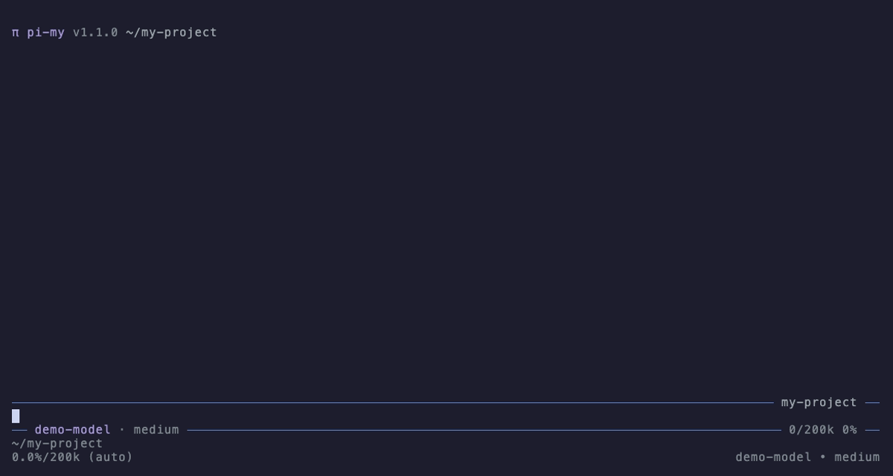

# pi-statusline

[](LICENSE) [](https://github.com/earendil-works/pi)

A header, winbar and statusline for [pi](https://github.com/earendil-works/pi), drawn on the editor's border.

- Header: one line with the version and the current directory, replacing the built-in header.
- Winbar, top-right of the editor border: the session name, or the directory name if the session has none.
- Statusline, bottom of the editor border: model and thinking level on the left, context usage (tokens used / context window and percent) on the right.

Segments read live state on every render and repaint on model, thinking level, session name, message, branch and compaction changes. Only interactive (TUI) mode is affected.



## Requires

> [!NOTE]
> Needs editor border widget slots (`borderTopRight`, `borderBottomLeft`, `borderBottomRight` widget placements) from upstream PR [earendil-works/pi#10602](https://github.com/earendil-works/pi/pull/10602).
> Until that merges, they are available on the `my` branch of the [msetsma/pi-my](https://github.com/msetsma/pi-my/tree/my) fork.

On stock pi the extension still loads, but the three segments render as plain widget lines above the editor instead of inside its border. The header works either way.

## Install

Add the package to `packages` in `~/.pi/agent/settings.json`, either from a local checkout:

```json
{ "packages": ["~/dev/pi-fork/pi-statusline"] }
```

or from git:

```json
{ "packages": ["git:github.com/msetsma/pi-statusline"] }
```

`pi install git:github.com/msetsma/pi-statusline` adds the git entry for you. Append `@<tag or commit>` to pin a version. `/reload` picks up edits to a local checkout.

## Configuration

None. There are no commands or keys.

## Development

`npm run check` typechecks against the fork's sources. It expects the fork checked out at `../pi-my` (on its `my` branch) with `node_modules` installed.

### Demo

`vhs demo/demo.tape` regenerates `demo/demo.gif`. It needs [vhs](https://github.com/charmbracelet/vhs) and the fork at `../pi-my`, and runs offline with a fake model (`demo/faux.ts`).
